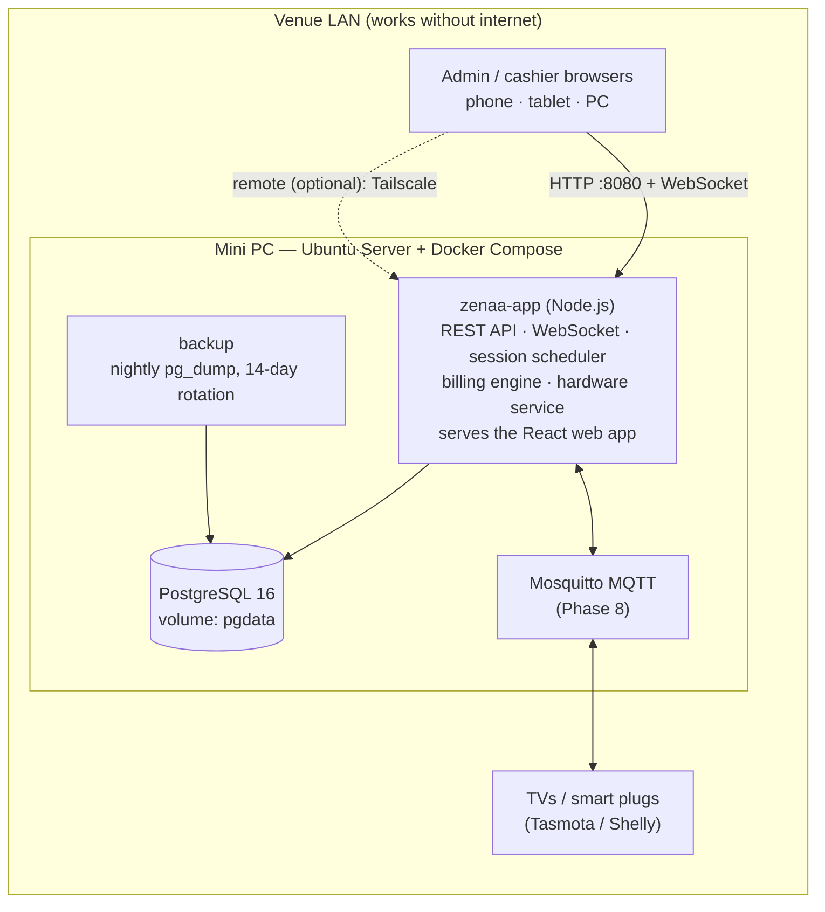

# 03 — Server OS & Technical Architecture

## 1. Server OS recommendation — **Ubuntu Server 24.04 LTS + Docker Compose**

Hardware: Intel Core i5 6th gen, 8 GB RAM, 250 GB SSD.

| Option | Verdict |
|---|---|
| **Ubuntu Server 24.04 LTS** | ✅ **Recommended.** Headless and uses about 0.5 GB RAM at idle, leaving roughly 7 GB for the app and database. Security updates until 2029. Docker runs natively. Skylake hardware is fully supported. Unattended security upgrades are easy to set up. |
| Windows 10/11 Pro | ❌ Docker runs inside a WSL2/Hyper-V VM, which costs about 2 GB RAM and adds an extra layer that can fail. Forced update reboots would interrupt live billing. Windows 10 is out of support. Windows 11 does not officially support 6th-gen CPUs. |
| Windows Server | ❌ Licence cost, heavier, and no benefit for this workload. |
| Docker-based | ✅ This is the *how*, not an alternative. All services run as containers on Ubuntu, so upgrades and rollbacks are one command. |

Expected footprint: PostgreSQL about 150–300 MB, app about 150 MB, Mosquitto under 10 MB. The database will stay well under 5 GB for years.

## 2. Services (only what has a purpose)

| Service | Purpose |
|---|---|
| `app` | One Node.js process: the API, real-time events, the session timer/expiry scheduler, the hardware drivers and the static web UI. |
| `db` | PostgreSQL 16. Ledgers and billing need real transactions, row locks and constraints. |
| `mqtt` | Mosquitto. Local broker for Tasmota plugs. Enabled in Phase 8. |
| `backup` | `pg_dump` every night plus before every upgrade, keeping 14 days. Copy off-box via USB or cloud folder. |

**Deliberately omitted:**
- **Redis.** There is a single server, so session state lives in PostgreSQL and in-process timers. Redis would add a failure point without benefit.
- **Separate reverse proxy.** The app serves the UI itself. Caddy can be added if HTTPS on the LAN is wanted.

## 3. Stack choices

| Layer | Choice | Why |
|---|---|---|
| Backend | Node.js 22 LTS, TypeScript, **Fastify** | Fast, typed, mature ecosystem for MQTT/HTTP device drivers. One language across front and back end. |
| ORM / migrations | **Drizzle ORM + drizzle-kit** | SQL-first, versioned SQL migrations committed to the repo. The same code runs on PostgreSQL in production and on **PGlite** (in-process Postgres) for development and automated tests. |
| Real time | **Socket.IO** | Automatic reconnection for phones and tablets that sleep or change Wi-Fi. |
| Validation | **zod** | Every request body is validated. |
| Auth | JWT (12 h) with a token version per user, so a password change or deactivation revokes sessions immediately. Passwords use scrypt. Role defaults plus per-user grant/revoke. |
| Frontend | **React 18 + Vite + TypeScript**, TanStack Query | A single-page app served by the server. Next.js SSR adds nothing on a LAN. |
| Styling | Hand-built design tokens (CSS variables) with dark/light themes | No framework lock-in and a consistent look. |

## 4. Timekeeping & billing correctness

- A session stores `accumulated_seconds` and `last_resumed_at`. Active time is `accumulated + (now − last_resumed_at)` while it runs. Every change is also written to `session_events` for audit.
- **Rate snapshot:** the plan, rate and discount are copied into the session at start. Later price changes never alter a running bill.
- **Prepaid expiry** is computed, not counted down. `expected_end = last_resumed_at + (allotted − accumulated)`. The scheduler closes the session *at that timestamp*, even if it notices late.
- **Heartbeat:** the server writes a heartbeat every 30 s. After an outage longer than 2 minutes, open sessions are paused at the last heartbeat (`system_pause`), and prepaid sessions that would have expired during the outage are ended at their true expiry time.
- **Money** is stored as integers (minor units) and rounded half-up exactly once per charge.
- **Wallet** changes take a row lock on the customer, append a ledger row with `balance_after`, and refuse to go negative.

## 5. Smart hardware strategy (verified constraints)

- **SONOFF S26 (R2)** runs eWeLink **cloud** firmware out of the box. Local control options, in order of reliability:
  1. **Flash Tasmota.** This needs a 3.3 V USB-serial adapter and opening the plug. It gives native local **MQTT** with no cloud, and is the recommended route.
  2. **Home Assistant** with the community *SonoffLAN* integration, using eWeLink's LAN mode where the firmware supports it. ZENAA would call Home Assistant's REST API.
  3. **SONOFF DIY mode** (local HTTP), which is **only available on some models and firmware versions**. Check yours before relying on it.
  4. The eWeLink cloud API needs a CoolKit developer registration and internet access. It is not used as the primary path.
- **The S26 has no power metering**, so it cannot tell whether a PS5 is in rest mode. Rules:
  - Use the S26 to switch the **TV/monitor** (safe).
  - **Never** auto-cut a plug feeding a PS5. Losing power while the PS5 is running can corrupt its storage.
  - If console power control is wanted, use a **metering plug** (e.g. SONOFF S31/POW, Shelly Plug S). ZENAA then refuses to switch it off while the draw is above the rest-mode threshold (about 5 W, configurable).
- Session end → TV warning → configurable delay → TV off. Every action is logged, and staff can override manually.

## 6. Network

- Give the mini PC a **fixed IP** through a DHCP reservation on the router (e.g. `192.168.1.10`). Staff open `http://192.168.1.10:8080`.
- Plugs sit on the same LAN and never need internet once flashed.
- Remote access: **Tailscale** (free tier), with no port forwarding. The app is never exposed directly to the internet.
- A small UPS on the mini PC and router is strongly recommended. PostgreSQL survives power cuts without corruption, but a UPS avoids the pause/recovery cycle.
